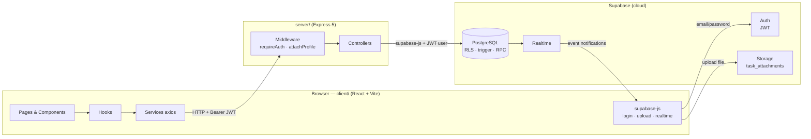
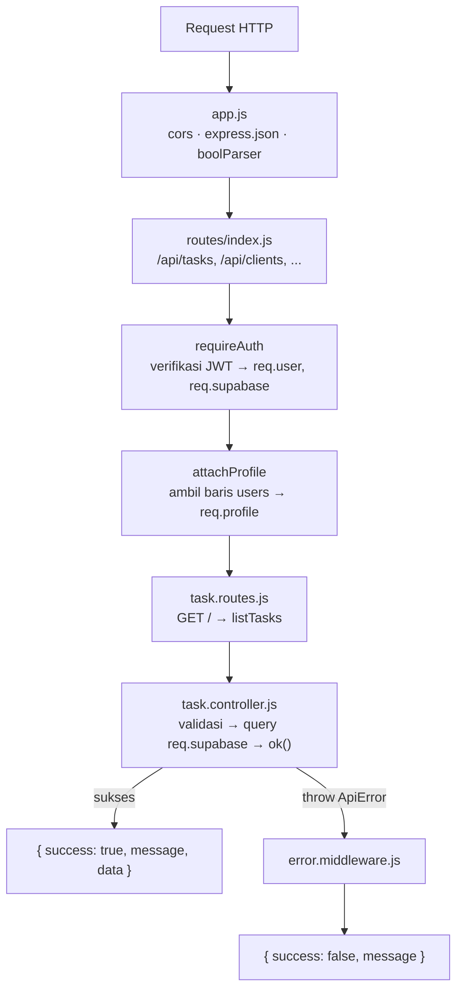
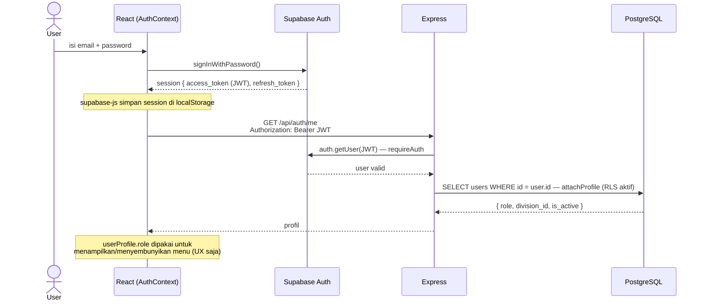
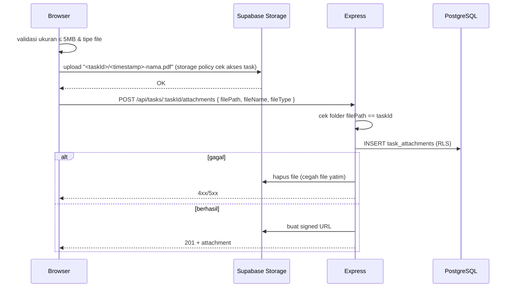
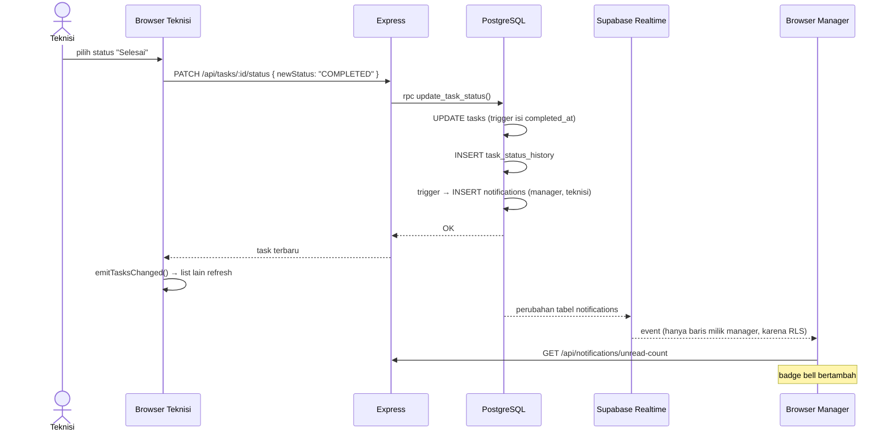
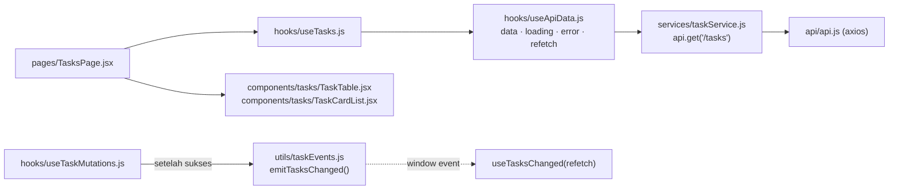

# Arsitektur Aplikasi

Gambaran besar bagaimana bagian-bagian Task Manager bekerja sama: dari klik di browser sampai
baris di database dan kembali lagi.

Dokumen terkait: [erd.md](erd.md) (struktur data) · [database.md](database.md) (RLS & trigger) ·
[tech-stack.md](tech-stack.md) (teknologi) · [api-contract.md](api-contract.md) (daftar endpoint).

---

## 1. Gambaran besar



Ada **dua jalur** dari browser ke Supabase:

1. **Lewat Express** (`/api/...`) — untuk semua baca/tulis data bisnis. Express memberi validasi,
   pesan error yang rapi, dan menggabungkan beberapa query.
2. **Langsung** dengan `supabase-js` — hanya untuk hal yang memang lebih cocok langsung:
   login (Auth), upload file besar (Storage), dan langganan event (Realtime).

Di kedua jalur, **JWT user selalu ikut**, sehingga RLS di PostgreSQL berlaku sama.

### Kenapa ada Express kalau Supabase sudah punya REST API?

Pertanyaan bagus untuk dipahami. Express di sini berfungsi sebagai:
- tempat validasi input & aturan bisnis (contoh: laporan hanya untuk task `COMPLETED`),
- penerjemah error database menjadi pesan & status HTTP yang jelas,
- tempat operasi yang butuh **service role key** rahasia (membuat akun user) — kunci ini tidak boleh ada di browser,
- tempat logika yang menggabungkan banyak query (snapshot laporan, export CSV, signed URL).

Tetapi **otorisasi** (siapa boleh melihat apa) tetap diserahkan ke RLS. Lihat
[database.md §10](database.md#10-catatan-penting-express-bukan-satu-satunya-pintu) untuk
konsekuensinya.

---

## 2. Struktur folder

```
Task-Manager/
├── package.json              # npm workspaces: client + server, script "dev" menjalankan keduanya
├── client/                   # Frontend (port 5173)
│   └── src/
│       ├── main.jsx, App.jsx # Entry: BrowserRouter → AuthProvider → ToastProvider → AppRoutes
│       ├── api/api.js        # Instance axios + interceptor (pasang JWT, tangani 401)
│       ├── services/         # 1 file per resource, hanya memanggil API (tanpa state)
│       ├── hooks/            # State + loading/error; use*Mutations untuk aksi tulis
│       ├── contexts/         # AuthContext (session & profil), ToastContext
│       ├── components/<fitur>/  # UI per fitur; components/ui/ = komponen umum
│       ├── pages/            # Satu file per halaman/route
│       ├── layouts/          # DashboardLayout (sidebar), PublicLayout (login)
│       ├── routes/           # AppRoutes + RouteGuards (Protected/Public/Admin)
│       ├── constants/        # Label & pilihan enum (Bahasa Indonesia)
│       └── utils/            # formatter, event bus (*Events.js), env
├── server/                   # Backend (port 3000)
│   ├── index.js              # Menyalakan server
│   ├── src/
│   │   ├── app.js            # Susunan middleware global
│   │   ├── config/           # env.js (baca .env), supabase.js (3 jenis client)
│   │   ├── middleware/       # auth, attachProfile, error, requireSuperAdmin, queryBoolean
│   │   ├── routes/           # Peta URL → controller
│   │   ├── controllers/      # Logika tiap endpoint
│   │   ├── utils/            # ApiError, ApiResponse, asyncHandler, queryParams, csv, ...
│   │   └── docs/swagger-ui.js   # Dokumentasi API di /api-docs
│   ├── prisma/               # schema.prisma + migrasi (tooling saja)
│   └── supabase/sql/         # RLS, function, trigger, grant, storage, realtime
└── docs/                     # Dokumentasi (kamu di sini)
```

---

## 3. Arsitektur server (berlapis)



### Tanggung jawab tiap lapisan

| Lapisan | File contoh | Tugas | Tidak boleh |
|---|---|---|---|
| Route | `routes/task.routes.js` | Memetakan method+URL ke fungsi | Berisi logika |
| Middleware | `middleware/auth.middleware.js` | Pekerjaan yang sama untuk banyak route | — |
| Controller | `controllers/task.controller.js` | Validasi input, panggil database, bentuk respons | Pakai Prisma / `supabaseAdmin` sembarangan |
| Utils | `utils/ApiResponse.js` | Fungsi kecil yang dipakai ulang | — |

### Tiga jenis Supabase client (`config/supabase.js`)

| Client | Kunci | RLS | Dipakai untuk |
|---|---|---|---|
| `supabaseAnon` | anon key | — | Hanya memverifikasi JWT (`auth.getUser`) |
| `createUserClient(token)` → `req.supabase` | anon key + JWT user | **Aktif** | **Semua query data user** |
| `supabaseAdmin` | service role key | **Di-bypass** | Hanya admin Auth: buat/hapus akun, ubah password |

### Pola penanganan error

```js
export const createTask = asyncHandler(async (req, res) => {   // 1. asyncHandler menangkap error async
  if (!title) throw new ApiError(400, "title is required");     // 2. lempar ApiError
  const { data, error } = await req.supabase.from("tasks").insert(...);
  if (error?.code === "23503") throw new ApiError(400, "Invalid clientId"); // 3. terjemahkan kode PG
  return created(res, data, "Task created");                    // 4. respons seragam
});
```

`errorHandler` di akhir rantai mengubah `ApiError` menjadi JSON. Error lain (bug) → `500` dan
dicetak ke console.

---

## 4. Alur autentikasi (login sampai request pertama)



- Interceptor di [`api/api.js`](../client/src/api/api.js) menempelkan JWT ke **setiap** request axios.
- Jika server membalas `401`, interceptor logout dan mengarahkan ke `/login`.
- `RouteGuards.jsx` mencegah halaman terlindungi dibuka tanpa session; `AdminRoute` khusus `SUPER_ADMIN`.
  Ini hanya kenyamanan UI — keamanan sebenarnya tetap di server & RLS.

---

## 5. Alur upload lampiran



Kenapa upload langsung ke Storage, bukan lewat Express? Supaya file besar tidak membebani server
Node dan tidak perlu library upload (multer). Trade-off-nya: ada dua langkah yang harus
dibersihkan bila langkah kedua gagal.

---

## 6. Alur ubah status → notifikasi realtime



---

## 7. Arsitektur client (alur data)



| Lapisan | Tugas | Contoh |
|---|---|---|
| **Service** | Satu fungsi = satu endpoint. Tidak punya state. Mengambil `response.data.data`. | `getTasks(params)` |
| **Hook** | Menyimpan state, loading, error. Umumnya membungkus `useApiData`. | `useTasks(params)` |
| **Mutation hook** | Aksi tulis (create/update/delete) + pesan error Indonesia. | `useTaskMutations()` |
| **Component** | Tampilan. Menerima data lewat props. | `TaskTable`, `TaskCardList` |
| **Page** | Merangkai hook + komponen, mengatur filter & dialog. | `TasksPage` |

### `useApiData` — hook generik

Menyimpan `data/loading/error`, mengambil ulang saat `params` berubah, dan memakai `requestId`
untuk membuang respons lama (mencegah *race condition*: hasil request lambat menimpa hasil yang lebih baru).

### Event bus sederhana (`utils/*Events.js`)

Setelah mutasi berhasil, panggil `emitTasksChanged()`. Komponen lain yang memakai
`useTasksChanged(refetch)` akan memuat ulang. Ini pengganti ringan library seperti React Query
atau Redux — cukup untuk skala proyek ini.

### Modal sebagai route (`backgroundLocation`)

`/tasks/:id` dan `/clients/:clientId` bisa tampil sebagai drawer di atas halaman list. Saat link
dibuka dengan `state.backgroundLocation`, `AppRoutes` merender halaman lama di belakang dan
detail di depan. URL tetap bisa dibagikan.

---

## 8. Format respons API

Semua endpoint JSON memakai bentuk yang sama ([`ApiResponse.js`](../server/src/utils/ApiResponse.js)):

```json
{ "success": true, "message": "OK", "data": { "tasks": [], "pagination": { "page": 1, "limit": 20, "total": 0, "totalPages": 0 } } }
```

```json
{ "success": false, "message": "Task not found or accessible" }
```

Daftar endpoint lengkap: [api-contract.md](api-contract.md) dan Swagger di `http://localhost:3000/api-docs`.
