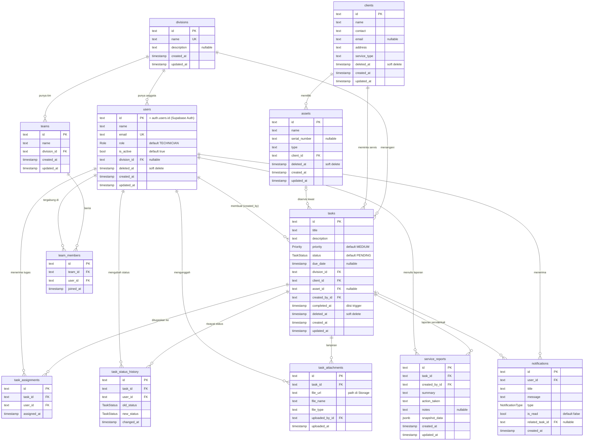
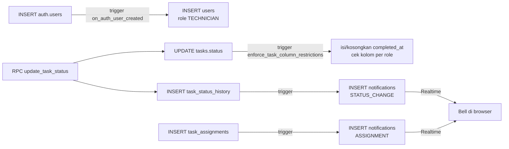

# ERD — Entity Relationship Diagram

Dokumen ini menjelaskan struktur database Task Manager: tabel apa saja yang ada, kolomnya,
dan bagaimana tabel-tabel itu saling terhubung.

> **Sumber kebenaran:** [`server/prisma/schema.prisma`](../server/prisma/schema.prisma)
> (struktur tabel) dan [`server/supabase/sql/`](../server/supabase/sql/) (aturan akses, trigger,
> function). Kalau dokumen ini berbeda dengan file tersebut, **file tersebut yang benar** — perbarui
> dokumen ini.

---

## 1. Diagram

Diagram ditulis dengan [Mermaid](https://mermaid.js.org/syntax/entityRelationshipDiagram.html),
otomatis tampil sebagai gambar di GitHub dan di VS Code (dengan ekstensi *Markdown Preview Mermaid*).

### Cara membaca notasi garis (crow's foot)

| Simbol | Arti | Contoh di proyek ini |
|---|---|---|
| `\|\|--o{` | satu ke **nol atau banyak** | 1 client bisa punya 0..n task |
| `\|o--o{` | **nol atau satu** ke nol atau banyak | task boleh tanpa asset (`asset_id` nullable) |

Sisi `||` = "wajib tepat satu", sisi `|o` = "boleh kosong", sisi `o{` = "boleh banyak, boleh nol".

---

## 2. Pengelompokan tabel

Lebih mudah dipahami kalau tabel dilihat per "domain":

| Domain | Tabel | Peran |
|---|---|---|
| **Organisasi** | `users`, `divisions`, `teams`, `team_members` | Siapa pengguna, ada di divisi mana |
| **Pelanggan** | `clients`, `assets` | Siapa yang dilayani dan perangkat apa |
| **Pekerjaan** (inti) | `tasks`, `task_assignments` | Tugas servis dan teknisi yang mengerjakan |
| **Jejak/audit** | `task_status_history`, `task_attachments`, `service_reports` | Bukti & riwayat pekerjaan |
| **Komunikasi** | `notifications` | Pemberitahuan in-app |

`tasks` adalah **pusat** dari ERD — hampir semua tabel lain menempel padanya.

---

## 3. Enum

| Enum | Nilai | Dipakai di |
|---|---|---|
| `Role` | `SUPER_ADMIN`, `MANAGER_DIVISION`, `TECHNICIAN`, `STAFF` | `users.role` |
| `Priority` | `LOW`, `MEDIUM`, `HIGH`, `URGENT` | `tasks.priority` |
| `TaskStatus` | `PENDING`, `IN_PROGRESS`, `ON_HOLD`, `COMPLETED`, `CANCELLED` | `tasks.status`, `task_status_history.old_status/new_status` |
| `NotificationType` | `ASSIGNMENT`, `STATUS_CHANGE`, `DEADLINE_REMINDER` | `notifications.type` |

Label Bahasa Indonesia untuk UI ada di [`client/src/constants/taskConstants.js`](../client/src/constants/taskConstants.js)
(contoh: `ON_HOLD` → "Menunggu Sparepart").

> `DEADLINE_REMINDER` sudah ada di enum tetapi **belum ada** yang membuatnya (belum ada job terjadwal).

---

## 4. Kamus data per tabel

Konvensi umum:
- **Primary key** semua tabel bertipe `text` berisi UUID (dibuat `crypto.randomUUID()` di server
  atau `gen_random_uuid()` di SQL).
- Nama kolom di database `snake_case` (`division_id`); di Prisma ditulis `camelCase` lalu dipetakan
  dengan `@map`. Di JSON API yang dikirim server, kolom tetap `snake_case` karena query memakai Supabase.
- `created_at` / `updated_at` ada di hampir semua tabel. `updated_at` diperbarui trigger
  `set_updated_at` (untuk `tasks` dan `users`).

### `users`
Profil aplikasi untuk setiap akun login.

| Kolom | Keterangan |
|---|---|
| `id` | **Sama dengan** `auth.users.id` milik Supabase Auth. Baris ini dibuat otomatis oleh trigger `on_auth_user_created` saat akun Auth dibuat. |
| `role` | Menentukan hak akses (lihat [RBAC.md](RBAC.md)). Default `TECHNICIAN`. |
| `division_id` | Nullable — `SUPER_ADMIN`/`STAFF` boleh tanpa divisi. Jika divisi dihapus → `SET NULL`. |
| `is_active` | Akun nonaktif ditolak di middleware `attachProfile` (403). |
| `deleted_at` | Soft delete. |

### `divisions`
Contoh isi: "Jaringan", "Perbaikan Komputer". `name` unik.

### `teams` & `team_members`
Tim kerja di dalam satu divisi; `team_members` adalah **tabel penghubung many-to-many** antara
`teams` dan `users` dengan `UNIQUE(team_id, user_id)` agar satu orang tidak masuk tim yang sama dua kali.

> Tabel ini **sudah ada di database tetapi belum dipakai** oleh API/UI (FR-11, FR-12). Lihat
> [roadmap.md](roadmap.md).

### `clients`
Pelanggan perusahaan. `deleted_at` untuk arsip (soft delete). Client yang masih dipakai task
**tidak bisa dihapus permanen** (`onDelete: Restrict`).

### `assets`
Perangkat milik client (router, PC, dll). Wajib punya `client_id`. Soft delete lewat `deleted_at`.

### `tasks` — tabel inti

| Kolom | Keterangan |
|---|---|
| `division_id` | Wajib. Menentukan teknisi mana yang boleh melihat task (teknisi hanya melihat divisinya). |
| `client_id` | Wajib. |
| `asset_id` | Opsional. Jika asset dihapus permanen → `SET NULL`. |
| `created_by_id` | Pembuat task. |
| `status` | **Jangan diubah lewat `UPDATE` biasa** — gunakan RPC `update_task_status()` agar riwayat tercatat. |
| `completed_at` | **Tidak diisi oleh aplikasi**. Trigger `enforce_task_column_restrictions` mengisinya `now()` saat status berubah menjadi `COMPLETED`, dan mengosongkannya bila status keluar dari `COMPLETED`. |
| `deleted_at` | Soft delete (hanya `SUPER_ADMIN`/`MANAGER_DIVISION`). |

Index: `status`, `due_date`, `division_id`, `completed_at` — kolom yang sering dipakai untuk filter.

### `task_assignments`
Tabel penghubung many-to-many `tasks` ↔ `users` (satu task bisa dikerjakan beberapa teknisi).
`UNIQUE(task_id, user_id)`. Policy RLS memastikan yang ditugaskan adalah `TECHNICIAN` aktif
**di divisi yang sama** dengan task. Insert baris di sini memicu notifikasi `ASSIGNMENT`.

### `task_status_history` — immutable
Log setiap perubahan status (siapa, dari apa, ke apa, kapan). Diisi oleh RPC `update_task_status()`.
Tidak boleh di-update/dihapus (audit trail). Insert baris di sini memicu notifikasi `STATUS_CHANGE`.

### `task_attachments`
Metadata file. **File aslinya** ada di Supabase Storage bucket `task_attachments` dengan path
`<task_id>/<timestamp>-<nama_file>`; `file_url` menyimpan path itu (bukan URL publik). Server
membuat *signed URL* sementara saat data dikirim ke client.

### `service_reports` — immutable
Laporan pekerjaan untuk task berstatus `COMPLETED`.

| Kolom | Keterangan |
|---|---|
| `snapshot_data` | JSON salinan kondisi task saat laporan dibuat (client, asset, teknisi, riwayat status). Dibangun server di [`serviceReportSnapshot.js`](../server/src/utils/serviceReportSnapshot.js). |

**Kenapa ada snapshot?** Data client/asset bisa berubah nanti (alamat pindah, asset diganti nama).
Laporan servis harus tetap menunjukkan kondisi *saat pekerjaan selesai*, seperti nota yang sudah dicetak.
Ini contoh **denormalisasi yang disengaja**.

### `notifications`
Notifikasi per user. Dibuat **hanya oleh trigger database** (bukan oleh API). User hanya bisa
membaca miliknya sendiri dan menandai `is_read = true`. Tabel ini masuk publikasi Supabase Realtime
sehingga bell di UI langsung berubah.

---

## 5. Aturan `ON DELETE` (apa yang terjadi saat data induk dihapus permanen)

| Relasi | Aturan | Artinya |
|---|---|---|
| `tasks` → `clients`, `divisions`, `users (created_by)` | `RESTRICT` | Tidak bisa hapus client/divisi/user yang masih punya task |
| `assets` → `clients` | `RESTRICT` | Tidak bisa hapus client yang masih punya asset |
| `service_reports` → `tasks`, `users` | `RESTRICT` | Laporan melindungi task dari penghapusan |
| `task_status_history.user_id`, `task_attachments.uploaded_by_id` | `RESTRICT` | Jejak audit melindungi user |
| `task_assignments`, `task_status_history`, `task_attachments` → `tasks` | `CASCADE` | Jika task dihapus permanen, anaknya ikut terhapus |
| `team_members` → `teams`/`users`, `teams` → `divisions`, `notifications` → `users` | `CASCADE` | |
| `tasks.asset_id`, `users.division_id`, `notifications.related_task_id` | `SET NULL` | Relasi opsional diputus |

Karena banyak `RESTRICT`, aplikasi ini **memakai soft delete** (`deleted_at`) untuk `users`,
`clients`, `assets`, dan `tasks`. Data tidak benar-benar hilang, hanya disembunyikan.

---

## 6. Hal-hal yang terjadi otomatis di database

Ringkasan; detail ada di [database.md](database.md).

---

## 7. Latihan memahami ERD

1. Tulis query SQL: daftar task milik client tertentu beserta nama teknisinya (JOIN `tasks` →
   `task_assignments` → `users`).
2. Kenapa `task_assignments` dibutuhkan, bukan kolom `technician_id` di `tasks`? (Petunjuk: FR-21.)
3. Apa yang terjadi jika `MANAGER_DIVISION` mencoba menghapus permanen client yang punya task?
4. Kenapa `completed_at` diisi trigger, bukan oleh frontend?
5. Rancang tabel `spare_parts` untuk FR-43: relasinya ke tabel mana?
